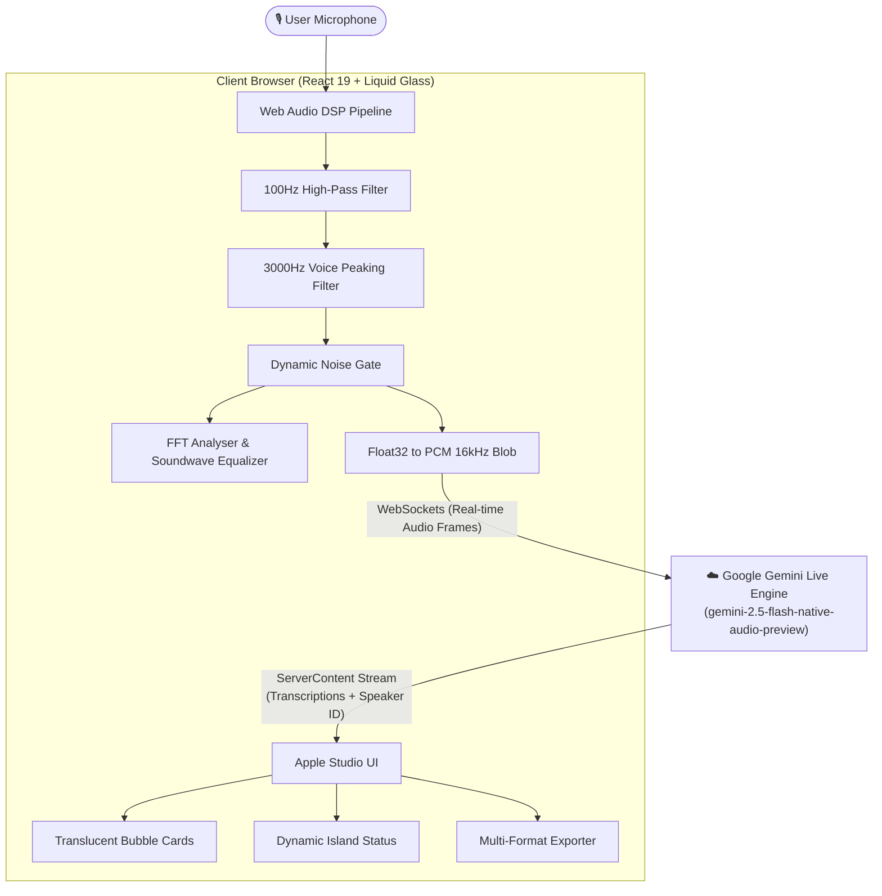

<div align="center">

# 🎙️ Voice-to-Text Caption Generator
### *Apple Studio Edition — Real-Time Multimodal Speech Recognition & Subtitle Synthesis*

[](https://ai.google.dev)
[](https://developer.apple.com/design/human-interface-guidelines)
[](https://react.dev)
[](https://www.typescriptlang.org)
[](https://vitejs.dev)
[](https://github.com/Rahul08319/Voice-to-Text-Caption-Generator/actions)

<br />

<p align="center">
  A state-of-the-art speech-to-text studio crafted with <b>Apple Liquid Glass ergonomics</b>, fluid spring motion, and real-time <b>Google Gemini Live Multimodal AI</b> streaming over WebSockets. Designed for live lectures, meetings, streaming subtitles, and accessibility.
</p>

[**Explore Live App**](https://ai.studio/apps/drive/1G7p34h7M_MCGBV-r_PhTcBsOVCKTynlN) • [**Report Bug**](https://github.com/Rahul08319/Voice-to-Text-Caption-Generator/issues) • [**Request Feature**](https://github.com/Rahul08319/Voice-to-Text-Caption-Generator/issues)

<br />

</div>

---

##  Apple Bento Grid — Core Capabilities

<table>
  <tr>
    <td width="50%" valign="top">
      <h3>💎 Liquid Glass & Cupertino HIG</h3>
      <p>Crafted following Apple's 2025–2026 Liquid Glass design language. Translucent glass materials (<code>backdrop-filter: blur(28px) saturate(190%)</code>), specular rim lighting, continuous squircle corners, and adaptive dark mode.</p>
      <ul>
        <li><b>Dynamic Island Top Bar</b> with live status pill and model indicators.</li>
        <li><b>Concentric Radar Waves</b> radiating from the record button.</li>
        <li><b>Sine-harmonic multi-band equalizer</b> bouncing in real-time.</li>
      </ul>
    </td>
    <td width="50%" valign="top">
      <h3>⚡ Gemini Live Audio WebSockets</h3>
      <p>Direct low-latency bidirectional PCM audio streaming at 16kHz directly to the <code>gemini-2.5-flash-native-audio-preview</code> model via WebSockets.</p>
      <ul>
        <li>Zero audio upload delay — words stream as you speak.</li>
        <li>Live typing indicator with breathing cursor.</li>
        <li>Real-time silence auto-stop detection (15s, 30s, 60s, continuous).</li>
      </ul>
    </td>
  </tr>
  <tr>
    <td width="50%" valign="top">
      <h3>👥 Multi-Speaker Diarization</h3>
      <p>Intelligently distinguishes between up to <b>5 distinct speakers</b> simultaneously in room meetings and multi-person interviews.</p>
      <ul>
        <li><b>Speaker 1:</b> Apple Electric Cyan (<code>#00C7BE</code>)</li>
        <li><b>Speaker 2:</b> Apple Royal Indigo (<code>#5E5CE6</code>)</li>
        <li><b>Speaker 3:</b> Apple Emerald Green (<code>#30D158</code>)</li>
        <li><b>Speaker 4:</b> Apple Radiant Amber (<code>#FF9F0A</code>)</li>
        <li><b>Speaker 5:</b> Apple Vivid Rose (<code>#FF375F</code>)</li>
      </ul>
    </td>
    <td width="50%" valign="top">
      <h3>🌐 Real-Time Live Translation</h3>
      <p>Seamlessly translates spoken speech on-the-fly into 12+ international languages with zero conversational filler.</p>
      <ul>
        <li><b>Spoken Input:</b> English, Spanish, French, German, Italian, Portuguese, Japanese, Korean, Mandarin, Hindi, Russian, Arabic.</li>
        <li><b>Live Target:</b> Instant translation into English, Spanish, French, German, Japanese, Mandarin, Russian, Korean, Italian.</li>
      </ul>
    </td>
  </tr>
  <tr>
    <td width="50%" valign="top">
      <h3>🎛️ Acoustic DSP Noise-Gate Filter</h3>
      <p>Browser-native Web Audio API signal processing pipeline that cleans background noise before sending audio to the AI:</p>
      <ul>
        <li><b>High-Pass Filter:</b> 100Hz cutoff to eliminate ambient mic rumble.</li>
        <li><b>Peaking Filter:</b> +3dB boost at 3000Hz for crisp vocal presence.</li>
        <li><b>Adaptive Noise Gate:</b> 0–100% threshold to mute background hum.</li>
      </ul>
    </td>
    <td width="50%" valign="top">
      <h3>💾 Multi-Format Subtitle Exporter</h3>
      <p>One-click professional export tailored for video editors, content creators, and accessibility compliance:</p>
      <ul>
        <li><b>.txt:</b> Formatted transcript with timestamps and speaker tags.</li>
        <li><b>.srt:</b> SubRip format with standard timecodes for video editing.</li>
        <li><b>.vtt:</b> WebVTT subtitles for modern HTML5 video players.</li>
        <li><b>.json:</b> Complete structured dataset with metadata.</li>
      </ul>
    </td>
  </tr>
</table>

---

## 🏛️ System Architecture



---

## ⌨️ Keyboard Shortcuts & Gestures

Designed with full macOS & Windows desktop ergonomics:

| Shortcut | Action | Description |
| :--- | :--- | :--- |
| <kbd>Space</kbd> | **Toggle Mic** | Start or stop real-time speech captioning |
| <kbd>Esc</kbd> | **Cancel** | Instantly stop live recording and finalize caption |
| <kbd>A-</kbd> / <kbd>A+</kbd> | **Dynamic Type** | Scale transcript typography (Small, Default, Large, XL) |
| <kbd>⌘</kbd> + <kbd>F</kbd> | **Search** | Filter through past transcript utterances |

---

## 🚀 Quick Start Guide

### Prerequisites
- [Node.js](https://nodejs.org/) v18.0.0 or higher
- A [Google Gemini API Key](https://aistudio.google.com/apikey)

### 1. Clone the Repository
```bash
git clone https://github.com/Rahul08319/Voice-to-Text-Caption-Generator.git
cd Voice-to-Text-Caption-Generator
```

### 2. Install Dependencies
```bash
npm install
```

### 3. Configure Your API Key
Create a `.env.local` file in the project root:
```env
GEMINI_API_KEY=your_gemini_api_key_here
```

### 4. Run Development Server
```bash
npm run dev
```
Open [http://localhost:3000](http://localhost:3000) in your browser to experience the studio!

### 5. Production Build
```bash
npm run build
npm run preview
```

---

## 🔄 Automated Maintenance for 2026 and Beyond

This repository incorporates **Automated Year & Health Logic**:
- **Dynamic Year Synchronization:** The application runtime dynamically computes `new Date().getFullYear()`, ensuring all footers, export metadata, and timestamps stay perpetually up-to-date across 2026, 2027, 2028, and beyond.
- **Continuous GitHub Actions Workflow:** Located at [`.github/workflows/auto-update-maintenance.yml`](.github/workflows/auto-update-maintenance.yml), the maintenance bot triggers:
  - **Weekly:** Automated dependency vulnerability auditing and build verification.
  - **Annually (Jan 1st):** Automatic year synchronization and documentation verification.

---

## 🎨 Design System Specifications

| Token | Specification | Preview |
| :--- | :--- | :--- |
| **Canvas** | Obsidian Deep Space (`#07080a`) |  Dark Background |
| **Liquid Glass** | `rgba(18, 22, 33, 0.72)` + `blur(28px)` | Frosted translucent surface |
| **System Cyan** | `#00C7BE` (Electric Cyan) |  Primary Accent |
| **System Blue** | `#0A84FF` (Cupertino Azure) |  Navigation Accent |
| **System Red** | `#FF375F` (Vivid Crimson) |  Recording Active |
| **Typography** | Apple SF Pro / Inter / JetBrains Mono | Continuous optical kerning |

---

## 📄 License & Attribution

Distributed under the **MIT License**. See `LICENSE` for more information.

<br />

<div align="center">
  <sub>Built with ❤️ by Rahul Kumar • Powered by Google Gemini AI &amp; Apple Design System</sub>
  <br />
  <sub>© 2025–2026 Voice-to-Text Caption Generator. All rights reserved.</sub>
</div>
